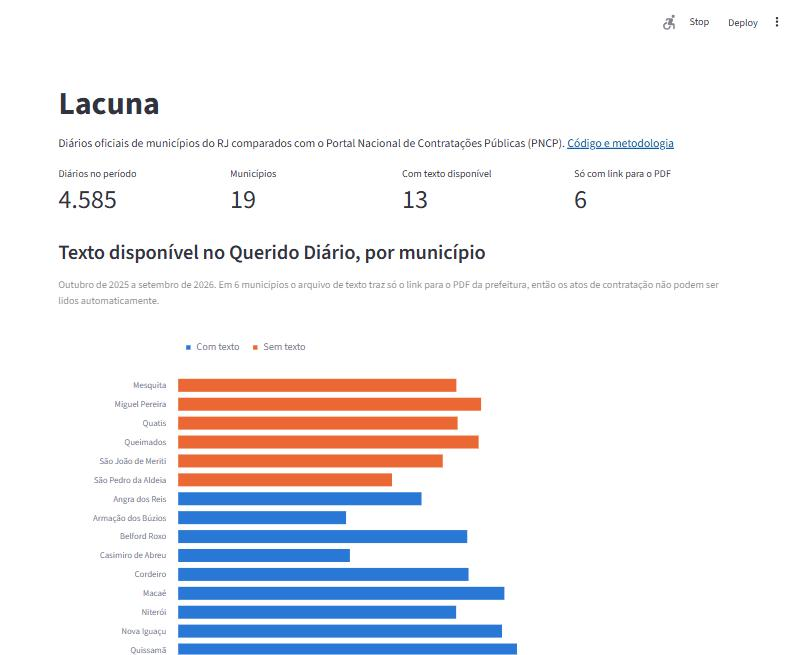

# Lacuna

[](https://github.com/juan-barross/lacuna/actions/workflows/ci.yml)
[](https://lacuna.streamlit.app)

Um em cada três extratos de contrato publicados nos diários oficiais de 13 municípios do RJ não tem registro correspondente no Portal Nacional de Contratações Públicas (PNCP).

O Lacuna lê os diários pelo [Querido Diário](https://queridodiario.ok.org.br/), separa os extratos de contrato, extrai empresa, CNPJ, valor e data, e procura cada extrato entre os contratos que as prefeituras registraram no [PNCP](https://pncp.gov.br/). Um extrato sem par é tratado como lacuna de dados: ele mostra que a informação não chegou ao portal federal e não diz nada sobre a legalidade do contrato.

[Ver o painel](https://lacuna.streamlit.app)

[](https://lacuna.streamlit.app)

## Resultado

O período vai de outubro de 2025 a setembro de 2026. Foram lidos 3.877 extratos de contrato, dos quais 2.649 são elegíveis (contrato com fornecedor e valor identificado), e baixados 8.373 contratos municipais do PNCP.

| | Extratos | % |
|---|---:|---:|
| Com par no PNCP | 1.676 | 63% |
| Provável (valor e data batem, o nome não confirma) | 141 | 5% |
| Sem par no PNCP | 832 | 31% |

Por município, com intervalo de confiança de 95% (Wilson):

| Município | Elegíveis | Com par | IC 95% |
|---|---:|---:|---|
| Quissamã | 122 | 89% | 83% a 94% |
| São José do Vale do Rio Preto | 446 | 85% | 82% a 88% |
| Saquarema | 473 | 78% | 74% a 81% |
| Macaé | 600 | 69% | 65% a 72% |
| Casimiro de Abreu | 22 | 59% | 39% a 77% |
| Armação dos Búzios | 30 | 53% | 36% a 70% |
| Cordeiro | 153 | 52% | 44% a 60% |
| Angra dos Reis | 23 | 48% | 29% a 67% |
| Niterói | 186 | 48% | 41% a 55% |
| Rio de Janeiro | 397 | 37% | 32% a 42% |
| Nova Iguaçu | 126 | 37% | 29% a 46% |
| Belford Roxo | 71 | 4% | 1% a 12% |

Belford Roxo publicou 71 extratos elegíveis no diário e registrou 52 contratos no PNCP no mesmo período.

Outros 6 municípios (Mesquita, Miguel Pereira, Quatis, Queimados, São João de Meriti e São Pedro da Aldeia) ficam fora da taxa porque o Querido Diário não tem o texto de nenhum diário deles, só o link para o PDF no site da prefeitura.

## Como funciona

```text
Querido Diário ──> diários (texto) ──> extratos de contrato ──> campos (regex ou LLM) ──┐
                                                                                        ├──> conciliação ──> painel
PNCP ──> órgãos municipais de cada cidade ──> contratos de cada órgão ──────────────────┘
```

1. Ingestão (`qd.py`, `pncp.py`): download com cache em disco, retentativa e espera quando a API limita o ritmo.
2. Segmentação (`segment.py`): cada extrato começa em "EXTRATO DO/DE CONTRATO" e vai até o próximo "EXTRATO".
3. Extração (`regex_baseline.py`, `llm.py`): um baseline de regex e o Claude Opus 5.5 pelo OpenRouter, com saída estruturada no mesmo esquema (`schema.py`). As respostas do LLM ficam em cache, com custo e latência de cada chamada.
4. Conciliação (`match.py`): mesmo município, valor a 1% e data a 60 dias; o nome da contratada (ou o CNPJ) decide entre casado e provável. As regras estão na [ADR 0005](docs/adr/0005-regras-de-conciliacao.md).
5. Avaliação (`evaluation.py`): F1 por campo contra um conjunto ouro rotulado à mão e precisão do casamento numa amostra conferida à mão.

## O que deu errado no caminho

Cada caso abaixo virou um teste.

A taxa depende muito da extração do nome. Em Cordeiro, o nome da contratada engolia o "CONTRATO N.º 233/2025" da linha seguinte, e a taxa passou de 8% para 52% depois da correção. Em Quissamã as partes vêm em "Celebrado entre o Município e a empresa X", sem rótulo (de 6% para 89%). Em Macaé o nome vinha grudado em "Macaé, 07 de Outubro de 2025" (de 56% para 69%).

Valores redondos casavam por coincidência: R$ 24.000,00 batia com contratos de outras empresas. Quando os dois nomes existem e são diferentes, o par agora é descartado.

O D.O.Rio repete no meio do texto a assinatura digital da gráfica municipal, com o CNPJ dela, e o regex pegava esse CNPJ como se fosse o da contratada. A segmentação tira esse cabeçalho de página.

As duas APIs têm armadilhas. O Querido Diário satura o total em 10.000 resultados e, desde dezembro de 2025, devolve parte dos links como `s3://` interno. O PNCP não filtra contratos por município, recusa períodos acima de 365 dias, devolve 204 sem corpo quando não há resultado e bloqueia por uns 27 s depois de 30 a 60 pedidos.

A máquina de desenvolvimento tem 4 GB de RAM. O Elasticsearch previsto no começo não coube, e a busca passou a usar o BM25 do DuckDB ([ADR 0004](docs/adr/0004-duckdb-no-lugar-do-elasticsearch.md)).

## Limitações

O conjunto ouro (250 trechos em `data/gold/fila.jsonl`) e a conferência dos casamentos (`data/gold/casamentos.csv`) estão preparados, mas ainda não foram rotulados. Até lá, a qualidade da extração e a precisão do casamento não estão medidas, e a taxa deve ser lida como estimativa.

O LLM já processou 85 dos 100 trechos do dev, a cerca de US$ 0,012 por trecho. A comparação com o regex depende dos rótulos.

Só entram extratos com o cabeçalho padrão; Sumidouro, por exemplo, quase não o usa. A contratação temporária de pessoal (1.216 extratos, quase todos de Saquarema) fica fora, porque não vai para o PNCP.

## Como rodar

Python 3.12.

```bash
python -m venv .venv
source .venv/bin/activate        # no Windows: .venv\Scripts\activate
pip install -e ".[dev,app]"
streamlit run app/streamlit_app.py
```

O painel usa os dados já incluídos em `app/data/`. Para refazer tudo a partir das APIs (algumas horas, por causa do limite do PNCP):

```bash
dxp qd-download && dxp pncp-download
dxp atos && dxp cobertura && dxp conciliar
```

Avaliação:

```bash
dxp amostra                      # sorteia os 250 trechos do conjunto ouro
streamlit run app/anotar.py      # rotula à mão, seguindo docs/guia_anotacao.md
dxp llm-fila --split dev         # extrai o dev com o LLM (OPENROUTER_API_KEY no .env)
dxp avaliar --extrator regex     # F1 por campo no dev
dxp avaliar --extrator llm
dxp precisao                     # depois de preencher data/gold/casamentos.csv
```

## Testes

```bash
pytest
```

São 141 testes, e nenhum acessa a internet: as APIs são simuladas com respostas gravadas. Um deles roda a CLI de ponta a ponta num diretório temporário, e três abrem os apps Streamlit sem navegador.

## Decisões

- [0001: recorte no RJ, out/2025 a set/2026, e municípios sem texto](docs/adr/0001-recorte-estado-periodo.md)
- [0002: Claude Opus 5.5 pelo OpenRouter na extração](docs/adr/0002-escolha-do-llm.md)
- [0004: BM25 no DuckDB no lugar do Elasticsearch](docs/adr/0004-duckdb-no-lugar-do-elasticsearch.md)
- [0005: regras de conciliação](docs/adr/0005-regras-de-conciliacao.md)

## Fontes

Querido Diário (Open Knowledge Brasil) e API de consultas do PNCP. Nenhuma das duas declara licença para os dados. O repositório não redistribui o dado bruto; guarda só contagens e os trechos de extratos usados no painel.
